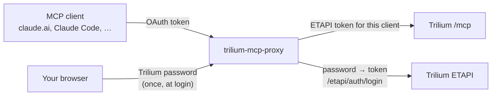
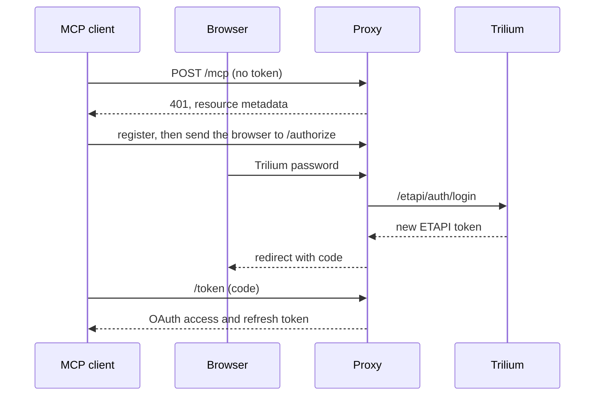

# How it works

The client only ever holds the proxy's OAuth tokens. The proxy swaps them for the client's ETAPI token on every request.

## Login

The login comes from [mcp-login-oauth](https://github.com/Marceltov/mcp-login-oauth), a small OAuth 2.1 server for MCP servers whose login is a form checked by the service behind them.

## Requests

Every request to `/mcp` with a valid OAuth token is forwarded to Trilium's `/mcp` unchanged, with only `Authorization` replaced by that client's ETAPI token. Responses stream back as they arrive, so long tool calls and event streams stay open as long as Trilium keeps them.

The one exception is the `initialize` answer: with `MCP_INSTRUCTIONS` set, the proxy adds it as `instructions`. Only that small response is read whole.

A request with a raw ETAPI token instead of an OAuth token is forwarded as is, and Trilium decides whether it's valid.

## Why a separate proxy

Trilium's built-in server is maintained upstream and gets new tools with every release; a transparent proxy picks them up for free. Adding OAuth to Trilium itself would be the cleaner end state, and the proxy can retire without anyone's tools changing. The decision is recorded in [ADR 0001](https://github.com/Marceltov/trilium-mcp-proxy/blob/main/docs/adr/0001-transparent-oauth-proxy-for-trilium-mcp.md).
